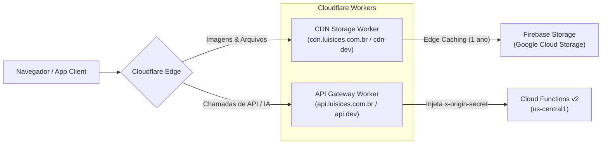

# ⛅ Automação da Cloudflare (Workers, CDN & API Gateway)

Este documento descreve a automação de Infraestrutura como Código (IaC) e CI/CD para a camada de borda da Cloudflare da plataforma **Luisices**.

---

## 🏛️ 1. Visão Geral da Arquitetura

A Cloudflare gerencia duas zonas e dois Workers essenciais:



---

## 📦 2. Os Workers

### A. CDN de Armazenamento (`cloudflare/cdn-worker`)
* **Domínios:**
  * **Produção:** `https://cdn.luisices.com.br` ➔ bucket `papelaria-dashboard.firebasestorage.app` (fallback: `.appspot.com`)
  * **Desenvolvimento:** `https://cdn-dev.luisices.com.br` ➔ bucket `luisices-dev.firebasestorage.app` (fallback: `.appspot.com`)
* **Principais Recursos:**
  * **Edge Caching Automático:** TTL de 1 ano em produção com cabeçalho `Cache-Control: public, max-age=31536000, immutable`.
  * **CORS Universal:** Trata `OPTIONS` preflight sem onerar a origem.
  * **Fallback Inteligente:** Se o bucket `.firebasestorage.app` retornar 404, faz failover automático no bucket `.appspot.com`.

### B. Gateway de API & Proteção de Origem (`cloudflare/api-worker`)
* **Domínios:**
  * **Produção:** `https://api.luisices.com.br` ➔ `https://us-central1-papelaria-dashboard.cloudfunctions.net`
  * **Desenvolvimento:** `https://api.dev.luisices.com.br` ➔ `https://us-central1-luisices-dev.cloudfunctions.net`
* **Principais Recursos:**
  * **Injeção de `x-origin-secret`:** Injeta automaticamente o token secreto de borda, impedindo que chamadas bypassando a Cloudflare acessem as Cloud Functions diretamente.
  * **CORS Preflight:** Responde imediatamente `OPTIONS` com headers CORS autorizados.
  * **Repasse de IP Real:** Encaminha `cf-connecting-ip` via `x-forwarded-for` para auditoria e rate limiting.

---

## 🚀 3. Comandos de Deploy Local (Wrangler)

Os comandos estão disponíveis diretamente via `npm run`:

```bash
# Deploy do CDN Worker
npm run cloudflare:deploy:cdn:dev    # Desenvolvimento (cdn-dev.luisices.com.br)
npm run cloudflare:deploy:cdn:prod   # Produção (cdn.luisices.com.br)

# Deploy do API Gateway Worker
npm run cloudflare:deploy:api:dev    # Desenvolvimento (api.dev.luisices.com.br)
npm run cloudflare:deploy:api:prod   # Produção (api.luisices.com.br)

# Deploy de ambos os Workers simultaneamente
npm run cloudflare:deploy:dev        # Todos os Workers em Dev
npm run cloudflare:deploy:prod       # Todos os Workers em Prod
```

---

## 🔐 4. Secrets Necessárias no GitHub Actions

Para que o pipeline automático funcione no GitHub Actions (`.github/workflows/deploy-cloudflare.yml`), configure em **Settings > Secrets and variables > Actions**:

| Secret | Descrição | Onde Obter |
| :--- | :--- | :--- |
| `CLOUDFLARE_API_TOKEN` | Token com permissão `Edit Cloudflare Workers` e `Zone:Edit` | Painel Cloudflare > My Profile > API Tokens |
| `CLOUDFLARE_ACCOUNT_ID` | ID da conta Cloudflare | Painel Cloudflare > Visão geral da conta |
| `ORIGIN_SECRET` | Token secreto compartilhado com as Cloud Functions | Secret Manager / `.env` da aplicação |

---

## 🤖 5. Pipeline CI/CD Automatizado

O workflow [`.github/workflows/deploy-cloudflare.yml`](../.github/workflows/deploy-cloudflare.yml) é acionado:
1. **Automaticamente:** Quando houver push nas branches `develop` (para Dev) ou `main` (para Prod) com alterações na pasta `cloudflare/**`.
2. **Manualmente:** Via `workflow_dispatch` na aba Actions do GitHub, permitindo escolher o ambiente (`dev`, `production` ou `all`) e quais workers publicar.
