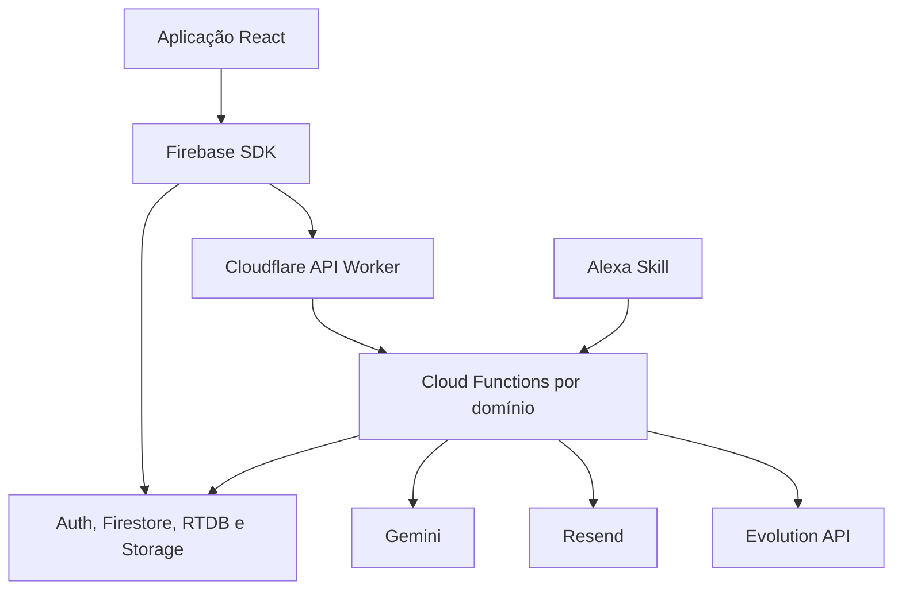

# Arquitetura e dependências

Revisão estrutural inicial: **10/10/2026**. Fluxos de pedidos e publicação atualizados em **25/10/2026**; inicialização das Functions em **26/10/2026**, na `develop`. Este mapa descreve relações verificáveis no repositório; não substitui inventário de serviços configurados na nuvem.

## Entrypoints e execução

- Frontend: [src/main.tsx](../src/main.tsx) → [src/app/App.tsx](../src/app/App.tsx) → [rotas](../src/app/routes.tsx).
- Backend: [functions/index.js](../functions/index.js), que resolve os exports por domínio sob demanda, preservando a descoberta completa no deploy. Firestore Admin prefere REST na nuvem; o emulador mantém gRPC. Estratégia, custos e validação em [Desempenho das Functions](DESEMPENHO_FUNCTIONS.md).
- Build: [vite.config.ts](../vite.config.ts), com React/TypeScript e saída em `dist`.
- Runtime de Functions: **Node.js 22**, em [firebase.json](../firebase.json) e [functions/package.json](../functions/package.json).
- O protótipo Express foi removido. Não existe backend Studio separado no fluxo publicado por esses workflows.

O navegador também utiliza serviços de observabilidade, consulta de CEP e URLs de mídia. O CDN de mídia é uma integração externa; não inferir configuração de cache, permissões do bucket ou disponibilidade apenas pelo domínio.

## Dependências por responsabilidade

| Área | Pacotes/serviços | Uso |
|---|---|---|
| Aplicação | React, React DOM, TypeScript, Vite, React Router | Componentes, tipagem, build e navegação |
| Interface | Tailwind, Radix, Lucide, Sonner, Motion | Estilos, componentes e feedback |
| Formulários | React Hook Form, Zod, resolvers | Entrada e validação |
| Dados | Firebase SDK | Auth, Firestore, RTDB, Storage, Analytics e Performance |
| Backend | firebase-admin, firebase-functions | Operações administrativas, callables e eventos |
| E-mail | Resend | Envio e webhook de recebimento |
| WhatsApp | Evolution API via HTTP | Envio, histórico e webhook |
| IA | Gemini via HTTP | Chat com ferramentas e análise de imagens |
| Voz | ASK SDK e verificação de requisições | Integração Alexa |
| Exportação | xlsx, jspdf, jspdf-autotable | Excel e PDF sob demanda |
| Segurança de conteúdo | DOMPurify | Sanitização de conteúdo exibido |
| Observabilidade | Sentry, Firebase Analytics/Performance | Erros e métricas do frontend |
| Testes | Vitest, Playwright, rules-unit-testing, Emulator Suite | Unitários, E2E e regras |
| Imagens | sharp | Otimização local de recursos |

Versões declaradas: [package.json](../package.json) e [functions/package.json](../functions/package.json).
Versões resolvidas: [package-lock.json](../package-lock.json) e [functions/package-lock.json](../functions/package-lock.json).
Um pacote listado não comprova que todos os seus recursos estejam habilitados. Por exemplo, dependências PWA não significam que haja um service worker ativo.

## Organização interna

| Local | Responsabilidade |
|---|---|
| `src/app/pages` e `src/app/components` | Telas, formulários e componentes |
| `src/services` | Operações e contratos de acesso Firebase |
| `src/hooks` e contextos | Assinaturas, autenticação e estado compartilhado |
| `src/app/utils` | Cálculos, formatação e regras reutilizáveis |
| `functions/users` | Contas, convites, claims, sessões e sincronização |
| `functions/orders` | Criação autoritativa, edição financeira, ledger/estatísticas atômicos, recibos, encomendas públicas e acompanhamento |
| `functions/email` | Envio, recebimento, anexos, idempotência e limpeza |
| `functions/whatsapp` | Conversas, autorização, integração e persistência de eventos |
| `functions/ai` | Prompt, schemas, repositórios, ferramentas e orçamento de uso |
| `functions/alexa` | Identidade, diálogo, rascunhos e criação confirmada |
| `functions/common` | Utilitários, limites e parâmetros compartilhados |

## Dados principais

| Grupo | Coleções/serviço usados |
|---|---|
| Operação | `orders`, `customers`, `products`, `quotes`, `gallery`, `exchanges` |
| Histórico financeiro | `salesLedger`, `salesMonthlySummaries` |
| Precificação | `supplies`, `pricingRecipes`, `pricingSettings`, `purchaseHistory`, `productionTracking` |
| Loja | `storeProducts`, `catalogOrders`, `storeSettings` |
| Usuários | `userProfiles` e preferências em `users` |
| Atendimento | `sentEmails`, `whatsapp_chats`, `whatsapp_messages` e coleções auxiliares dos módulos |
| Presença | Realtime Database, separado do Firestore |
| Mídia | Cloud Storage e URLs de CDN |
| IA/Alexa | Registros de uso, orçamento, vínculos e rascunhos gerenciados pelos módulos |

Este quadro não é uma concessão de acesso. Regras executáveis: [Firestore](../firestore.rules), [RTDB](../database.rules.json), [Storage](../storage.rules); operações privilegiadas também validam o chamador nas Functions.

## Pedidos: gravação e recuperação

Toda criação do painel, incluindo importações e duplicações, usa `createOrder`. A Function valida autorização/dados e grava pedido, ledger, contador, estatísticas e eventos iniciais na transação. O Firestore nega criação direta pelo cliente. Edições financeiras, alterações de itens e mudanças de cliente vinculado usam `updateComplexOrder`; a edição do modal também usa essa Function quando há `operationId`, mesmo se os valores já aparecem no documento. Outros fluxos não financeiros continuam nas regras de atualização permitidas.

As mutações via Admin SDK não consomem avaliações das regras client-side. Isso retira esses cálculos do caminho sujeito ao limite CEL, mantendo as regras como barreira para acessos diretos. O limite funcional permanece de 1 a 10 itens estruturados; pedidos simples/legados sem lista são aceitos quando válidos.

Na criação, o ID e o hash do comando distinguem repetição de nova compra. Na edição, `orders/{id}/operationReceipts/{operationId}` vincula usuário, comando e versão aplicada. Recibos são privados ao backend e preservados. O cliente conserva comandos pendentes por usuário/fluxo na mesma sessão e confirma pelo backend, em vez de inferir sucesso pelo estado atual. Ver [idempotência](IDEMPOTENCIA_PEDIDOS.md) e [segurança/CEL](SEGURANCA_LIMITE_CEL_PEDIDOS.md).

Uploads, cadastro prévio do cliente e baixa de estoque da calculadora não pertencem à transação do pedido. A garantia de idempotência do pedido não torna esses processos atômicos.

## IA: fluxo e limites

A UI envia mensagem, histórico limitado e imagem opcional a `aiAgentChat`. O backend valida a sessão, resolve escopo, reserva orçamento, prepara contexto autorizado e chama o modelo com as ferramentas declaradas. As ferramentas consultam dados ou retornam rascunhos; handlers montam boa parte das respostas de forma determinística.

Quando várias ferramentas são chamadas, pode haver uma rodada adicional de síntese. A configuração limita o trabalho por solicitação. Consultas de pedidos percorrem páginas até um teto operacional; limitar a lista exibida não garante uma quantidade equivalente de leituras no Firestore.

O cache é em memória e não é compartilhado por todas as instâncias. O orçamento possui persistência própria; a telemetria detalhada de consumo de tokens no Firestore foi desativada. Veja [Copiloto](COPILOTO_IA.md).

## Publicação e configuração

A [configuração Firebase](../firebase.json) aponta para regras e índices versionados. O workflow [DEV](../.github/workflows/deploy-dev.yml) pode publicar Hosting, Functions, Firestore/RTDB/Storage e índices. O frontend de DEV depende do sucesso do deploy de Functions quando ambos mudam. O [workflow de produção](../.github/workflows/deploy.yml) publica o frontend por artefato no GitHub Pages e regras; o [workflow de Functions](../.github/workflows/deploy-functions-manual.yml) publica automaticamente o backend quando `functions/**` ou `firebase.json` mudam na `main`, além da execução manual.

Parâmetros secretos devem ser fornecidos pelos mecanismos de secrets do ambiente. Templates públicos devem conter somente nomes e placeholders. Rotação, permissões de contas de serviço e estado de deploy precisam ser verificados na infraestrutura; não são comprovados por este documento.

## Custo e evolução

- Paginar antes da leitura evita carregar coleções inteiras para depois usar `slice`.
- O histórico completo usado por telas e agregações merece medição de leituras, latência e crescimento.
- Carregar contexto de catálogo em cada solicitação de IA pode custar leituras e tokens mesmo para perguntas simples.
- Limitar o tamanho do prompt, reutilizar dados dentro da mesma requisição e usar respostas determinísticas pode reduzir trabalho; a economia deve ser medida.
- Índices e resumos materializados exigem contratos de atualização, recomputação e definição de período.
- Agrupar modelos sob uma única tarifa ou ignorar tentativas de fallback pode distorcer a estimativa de IA.

Os **771 testes em 73 arquivos** pertencem à revisão documental anterior. Nesta revisão de pedidos, passaram 195 testes unitários/regressão focados e 171 de integração focada, além de typecheck, build e sintaxe de 68 arquivos de Functions. Após adaptar os testes de importação à Function, a integração completa local teve 266 aprovações, zero falhas e seis testes RTDB reservados ao comando próprio. A suíte unitária completa local teve 1.317 aprovações e uma falha de ambiente do `sharp` no Android; a CI Linux confirmou os 1.318 unitários. Esses resultados não comprovam carga ou publicação. O estado de cada run é a fonte para E2E e deploy.

## Responsabilidades e refatoração gradual

As versões atuais e os critérios de instalação estão nos manifests e no [guia do backend](../functions/README.md); os resultados históricos da migração estão no [changelog](../CHANGELOG.md).

O critério de modularização é a responsabilidade, não apenas a quantidade de linhas. Telas devem coordenar a interação; regras de domínio devem ser testáveis separadamente; consultas e gravações devem permanecer em componentes de acesso a dados identificáveis. Evite módulos genéricos de utilidades que misturem domínios distintos.

Primeira separação aplicada ao diálogo de voz:

| Módulo | Responsabilidade |
|---|---|
| [dialogInput.js](../functions/alexa/dialogInput.js) | Validar e normalizar entradas, sem consultar ou gravar dados |
| [dialogSpeech.js](../functions/alexa/dialogSpeech.js) | Formatar e sanitizar respostas, sem acesso à persistência |
| [dialogPrompts.js](../functions/alexa/dialogPrompts.js) | Escolher a próxima pergunta a partir do estado recebido, sem consultas ou gravações |
| [dialog.js](../functions/alexa/dialog.js) | Orquestrar estados, integrações, consultas e persistência; manter a interface pública existente |

As funções foram movidas preservando seus corpos e os exports públicos de `dialog.js`. Os testes existentes verificam o comportamento do fluxo e, no teste básico de diálogo, as funções de entrada e formatação são importadas diretamente dos módulos responsáveis. A separação não elimina a concentração de responsabilidades do processador principal; sua decomposição por intenções permanece como próxima etapa.

Ordem sugerida para os próximos grupos:

| Prioridade | Área | Próxima separação | Critério de validação |
|---|---|---|---|
| 1 | Diálogo de voz | Consultas de catálogo e pedidos, seguidas dos handlers por intenção | Preservar transições, respostas, autorização e gravações com testes de cenário |
| 2 | E-mails | Separar envio, webhook e limpeza em módulos próprios após isolar `getEmailUsage` | Preservar idempotência, anexos, assinatura do webhook, autorização e limpeza de dados |
| 3 | Catálogo público | Seleção/sacola, envio da encomenda e apresentação dos produtos | Preservar valores, dados enviados e validação do formulário |
| 4 | Personalização da loja | Estado e persistência separados dos componentes de apresentação | Preservar o resultado salvo e a prévia da loja |

Cada grupo deve ser uma mudança revisável, com validação em DEV antes de produção. Mantenha os contratos públicos enquanto há consumidores antigos; qualquer remoção de compatibilidade deve ser uma mudança explícita. Refatorações estruturais não devem ser misturadas com novos recursos ou mudanças visuais no mesmo grupo.
