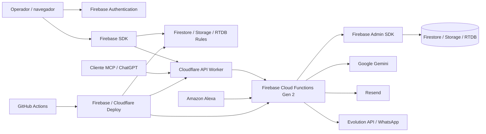

# Modelagem de ameaças — Luisices

**Data da revisão:** 26/10/2026
**Branch observada:** `develop`
**Tipo de revisão:** análise estática do repositório; não foi feita avaliação de produção, teste de invasão ou auditoria da configuração do Google Cloud/Cloudflare.
**Público:** responsável pelo produto, desenvolvimento e revisão técnica.

## 1. Objetivo e limites

Este documento identifica caminhos plausíveis para comprometer confidencialidade, integridade, disponibilidade ou custo do Luisices e define ações para reduzir esses riscos. Ele usa STRIDE como estrutura para não esquecer classes comuns de ameaça: falsificação, adulteração, negação de autoria, divulgação de informação, negação de serviço e elevação de privilégio.

A análise é baseada no código, nas regras e na configuração versionada encontrados no repositório. As alterações de contingência do gateway presentes no working tree também foram consideradas, mas ainda não estão commitadas. Não é possível confirmar por este documento:

- se `develop` ou `main` já foram implantadas nos projetos Firebase;
- se as regras, Functions, Workers, secrets, IAM, domínios, WAF e alertas publicados correspondem ao repositório;
- se administradores usam MFA, se as contas de serviço seguem privilégio mínimo ou se há proteção de branches;
- se backups, retenção, resposta a incidentes e recuperação foram testados;
- se dados reais foram expostos ou se existe vulnerabilidade explorável em produção.

As classificações abaixo são prioridades preliminares de engenharia, não uma certificação de segurança.

## 2. Sistema e fluxo de dados

O navegador é não confiável mesmo quando a aplicação oficial é usada. As regras Firebase protegem operações feitas pelo SDK cliente; o Admin SDK usado pelas Functions ignora essas regras, portanto cada endpoint precisa fazer sua própria autorização e validação. O Worker protege a origem e fornece uma camada de entrada, mas não substitui as verificações no backend.

## 3. Ativos e impacto

| Ativo | Exemplos | Impacto se comprometido |
|---|---|---|
| Dados pessoais | Nome, telefone, e-mail, observações e imagens de clientes | Privacidade, fraude, dano à reputação e obrigações de resposta a incidente |
| Pedidos e operação | Itens, quantidades, preços, status, prazos e anexos | Perda ou alteração de encomendas e interrupção do trabalho |
| Dados financeiros | Pagamentos, estornos, `salesLedger`, resumos e totais de clientes | Decisões financeiras incorretas, perda de rastreabilidade e disputa de valores |
| Identidades e permissões | Firebase Auth, `userProfiles`, sessões, dispositivos e convites | Tomada de conta, privilégio indevido ou acesso persistente após revogação |
| Segredos de integração | `ORIGIN_SECRET`, Gemini, Resend, Evolution, chaves de tracking/MCP/Alexa | Acesso ao backend, uso fraudulento de serviços e custos inesperados |
| Arquivos e mídias | Fotos da galeria, produtos, anexos de pedidos/e-mail e imagens públicas | Exposição de dados, conteúdo malicioso ou abuso de armazenamento/processamento |
| Disponibilidade e confiança | Firestore, Functions, Worker e deploy | Impossibilidade de salvar pedidos, corrupção de dados ou publicação de código inseguro |

Dados de cartão completo não devem ser coletados nem armazenados; o código observado trabalha com valores, métodos e histórico de pagamentos. Confirmar essa fronteira em integrações e interfaces.

## 4. Atores e capacidades

- **Visitante anônimo:** pode consultar rotas públicas da loja e tracking, além de tentar abusar de endpoints acessíveis sem login.
- **Usuário autenticado comum:** pode tentar alterar requisições, ignorar a interface, chamar Firebase diretamente ou explorar permissões amplas.
- **Funcionário:** possui permissões por módulo e pode estar atribuído a pedidos; erro de escopo pode expor dados de outro usuário.
- **Administrador:** tem acesso amplo; tomada de conta administrativa possui impacto elevado.
- **Ex-funcionário ou sessão revogada:** pode tentar reutilizar token ainda válido ou sessão em outro dispositivo.
- **Atacante com conta comprometida:** usa credenciais válidas para exfiltrar ou alterar dados sem precisar quebrar autenticação.
- **Atacante externo de webhook:** envia eventos falsos, replays ou payloads enormes para endpoints públicos.
- **Terceiro ou chave de integração comprometida:** abusa de APIs externas ou envia eventos maliciosos.
- **Atacante da cadeia de fornecimento:** compromete dependência, GitHub Actions, credencial de deploy ou conta de mantenedor.
- **Insider malicioso ou erro operacional:** altera, apaga ou publica dados usando permissões legítimas.

## 5. Fronteiras de confiança

1. **Navegador → Firebase Auth:** tokens identificam o usuário, mas XSS ou dispositivo comprometido pode agir como esse usuário.
2. **Navegador → Firestore/Storage/RTDB:** regras são a barreira de acesso para operações diretas; toda regra permissiva deve considerar chamadas forjadas.
3. **Navegador → Cloudflare Worker → Functions:** o Worker injeta `ORIGIN_SECRET`. O fallback direto de contingência do cliente foi removido; todas as gravações de pedidos exigem trânsito pelo Worker oficial. Timeouts e falhas de transporte são tratados como estado inconclusivo com chave determinística, sem contornar a borda.
4. **Function → Admin SDK:** código privilegiado pode ler/gravar além do que o usuário poderia fazer diretamente; erros de autorização aqui têm impacto alto.
5. **Functions → terceiros:** dados selecionados podem sair para Gemini, Resend, Evolution/WhatsApp e Alexa.
6. **GitHub Actions → ambientes:** secrets e permissões dos workflows podem publicar regras, frontend, Worker e Functions.
7. **URLs públicas de arquivos:** Storage/CDN pode expor mídias por desenho; URLs não devem ser tratadas como autorização para dados privados.

## 6. Controles observados no repositório

- Firestore, Storage e RTDB têm regras versionadas e terminam sem regra geral de abertura observada; a autorização combina usuário ativo, proprietário, papel e permissões.
- Criação de pedidos do painel é negada diretamente nas regras e feita por `createOrder`; edições financeiras complexas passam por `updateComplexOrder`.
- A criação/edição de pedidos usa transações, controle de versão e recibos/chaves idempotentes documentados.
- Perfis não podem ser criados ou apagados diretamente pelo cliente; a alteração client-side do próprio perfil é limitada a campos de exibição/telefone.
- Dados de sessão, recibos, payment events, links de tracking, segredos de MCP/Alexa e registros de integração são inacessíveis diretamente pelo cliente em regras explícitas.
- `assertActiveSession` verifica perfil ativo e `tokensValidAfterTime`; regras de Firestore também comparam `auth_time`.
- Webhook Resend valida assinatura Svix e janela temporal; Alexa valida assinatura/timestamp e depois compara Skill ID ativo; webhook Evolution exige segredo de API e origem.
- Rate limits existem para algumas operações de usuários, e-mail, WhatsApp, IA, Alexa e rotas públicas. O Worker tem limite explícito para tracking público.
- Sentry sanitiza vários identificadores e conteúdo de requisições antes do envio.

Esses controles foram observados em código. A presença no repositório não prova execução ou configuração correta no ambiente publicado.

## 7. Registro de ameaças e ações

### T1 — Acesso cruzado entre proprietários ou permissões de funcionário

- **STRIDE:** elevação de privilégio, divulgação de informação.
- **Cenário:** funcionário consulta/edita pedido, cliente, arquivo ou registro financeiro de outro proprietário manipulando IDs ou consultas.
- **Controles observados:** regras e handlers verificam proprietário, `assignedTo`, status ativo e permissões por módulo; Functions críticas revalidam o acesso.
- **Risco residual:** cada coleção, subcoleção, URL de mídia, ferramenta de IA/MCP e fluxo de exportação precisa repetir o mesmo escopo. Uma consulta ampla pode vazar dados mesmo que a tela filtre corretamente.
- **Prioridade:** alta, por impacto de privacidade.
- **Ações:** manter testes negativos multiusuário para cada coleção/endpoint; testar funcionário atribuído e não atribuído; verificar acesso em exportações, relatórios, anexos e ferramentas de IA/MCP; usar dados sintéticos para testes.

### T2 — Bypass do gateway em gravação de pedidos

- **STRIDE:** elevação de privilégio, negação de serviço, adulteração.
- **Cenário:** no desenho inicial avaliado, cogitou-se permitir fallback regional direto autenticado caso o gateway Cloudflare falhasse. Um cliente malicioso poderia fazer chamadas diretas intencionais para contornar controles de borda do Worker.
- **Controles observados:** o mecanismo de fallback e qualquer exceção foram removidos do wrapper e dos endpoints; chamadas diretas sem `ORIGIN_SECRET` são rejeitadas pelo wrapper com `permission-denied`, tanto para anônimos quanto para usuários autenticados. Os handlers mantêm autorização e idempotência no servidor.
- **Risco residual:** mitigado no código local revisado. Como esta revisão é estática, a eficácia em produção depende de a versão publicada corresponder ao repositório e de o segredo de origem estar devidamente provisionado e restrito ao Worker.
- **Prioridade:** mitigada no código local; pendente de verificação no ambiente publicado após deploy.
- **Ações:** manter a proteção de origem estrita sem fallback regional no cliente. Timeouts no gateway preservam a chave determinística para retentativa autoritativa pelo mesmo caminho oficial.

### T3 — Manipulação ou remoção de `salesLedger` pelo cliente

- **STRIDE:** adulteração, negação de autoria.
- **Cenário:** as regras permitem `create`/`update` do ledger sob condições de proprietário/admin/funcionário e permitem `delete` ao proprietário ou admin. A validação espelha campos financeiros do pedido em certas operações, mas a existência de acesso de escrita direta deve ser avaliada contra o propósito de histórico financeiro e reconciliação.
- **Impacto:** relatórios ou trilhas podem ficar incompletos ou incoerentes se campos não financeiros puderem ser alterados, ou se uma venda puder ser apagada sem apagar o pedido.
- **Prioridade:** alta para integridade financeira.
- **Ações:** decidir quais campos de ledger realmente precisam de edição pelo navegador; mover campos financeiros e eventos para escrita exclusiva das Functions; restringir `affectedKeys`; bloquear exclusão física ou substituí-la por marcação auditada; adicionar testes de adulteração e exclusão.

### T4 — Alteração de agregados financeiros de cliente

- **STRIDE:** adulteração.
- **Cenário:** a regra de `customers` permite atualização a usuários com permissão de edição, desde que o documento continue válido; revisar se `totalSpent` e `totalOrders` podem ser alterados diretamente, embora sejam atualizados como agregados pelo backend.
- **Impacto:** relatórios e métricas do cliente deixam de corresponder aos pedidos.
- **Prioridade:** média/alta.
- **Ações:** tratar agregados como campos somente do backend; usar allowlist de campos mutáveis no update; validar recomputação e migração dos dados existentes antes de alterar regras.

### T5 — Exposição de arquivos por caminhos públicos

- **STRIDE:** divulgação de informação.
- **Cenário:** Storage permite leitura pública para determinados diretórios dentro de `users/{userId}`, incluindo caminhos chamados `customers` e `products`; o bucket também tem diretórios públicos. Isso pode ser correto para imagens públicas, mas é perigoso se arquivos pessoais ou anexos forem armazenados nesses prefixos.
- **Impacto:** divulgação de imagens, nomes, documentos ou URLs com capacidade de acesso.
- **Prioridade:** alta se dados pessoais estiverem nesses caminhos; caso contrário, média.
- **Ações:** inventariar objetos reais por prefixo; classificar cada pasta como pública/privada; mover arquivos sensíveis para caminhos privados; não usar nome de pasta nem URL secreta como única autorização; testar regras de leitura anônima.

### T6 — Upload de conteúdo disfarçado

- **STRIDE:** adulteração, execução/abuso de conteúdo, negação de serviço.
- **Cenário:** Storage Rules verificam `contentType`, tamanho e caminho, mas esse metadata é fornecido pelo cliente; não prova o tipo real dos bytes. A validação server-side observada para anexos de e-mail não significa que todo upload de imagem seja inspecionado no backend.
- **Impacto:** armazenamento de arquivo inesperado, falha em processadores, conteúdo ativo ou custo de processamento.
- **Prioridade:** média/alta conforme os consumidores dos arquivos.
- **Ações:** validar assinatura/estrutura real no backend para fluxos de maior risco; para anexos, usar quarentena antes de envio; manter allowlist curta; impedir SVG/HTML executável onde não for indispensável; servir com `nosniff`; testar arquivo com MIME forjado e assinatura truncada.

### T7 — Abuso de endpoints públicos e consumo de recursos

- **STRIDE:** negação de serviço, fraude/custo.
- **Cenário:** checkout público, tracking, mídia ou integrações recebem tráfego automatizado. Parte dos rate limits usa `RateLimiterMemory`, que é local à instância e pode perder estado em reinicialização ou não ser compartilhado entre instâncias. Cloudflare aplica limite específico de tracking no Worker; a proteção não deve ser generalizada para todos os endpoints.
- **Impacto:** spam de encomendas, exaustão de quota, latência, custos e indisponibilidade para operadores.
- **Prioridade:** alta para endpoints públicos com efeito persistente; média para leitura pública.
- **Ações:** usar rate limit distribuído/na borda para rotas públicas; limitar payload e custo antes de chamadas a terceiros; adicionar idempotência no checkout; monitorar volume, erros e custo; testar burst e limites de instância.

### T8 — Spoofing ou replay de webhook

- **STRIDE:** falsificação, adulteração, repetição.
- **Cenário:** atacante envia eventos falsos para Evolution, Resend ou Alexa, ou repete um evento legítimo para duplicar mensagens/efeitos.
- **Controles observados:** Evolution usa API key; Resend verifica assinatura Svix e timestamp; Alexa verifica assinatura/timestamp e Skill ID; processamento de alguns eventos usa IDs/deduplicação.
- **Risco residual:** rotação de segredos, tolerância a replay e deduplicação precisam ser verificadas por integração e configuração remota. Webhooks não devem confiar apenas em origem/IP ou CORS.
- **Prioridade:** alta.
- **Ações:** manter assinatura sobre corpo bruto; validar janela temporal; armazenar IDs de evento processados de modo atômico; testar assinatura inválida, timestamp expirado e replay; limitar tamanho e taxa.

### T9 — Comprometimento de conta administrativa ou sessão revogada

- **STRIDE:** falsificação, elevação de privilégio.
- **Cenário:** credencial/admin token roubado, dispositivo compartilhado ou token reutilizado após desativação/revogação.
- **Controles observados:** funções e regras consultam perfil ativo e timestamp de revogação; há gerenciamento de dispositivos/sessões.
- **Risco residual:** MFA, política de senha, alertas de login, tempo de sessão e recuperação de conta são configurações operacionais externas e não comprovadas pelo código.
- **Prioridade:** alta.
- **Ações:** exigir MFA para admins; revisar quem tem papel admin; testar revogação com token emitido antes/depois do timestamp; alertar alterações de papel, permissões, segredos e último admin; documentar recuperação de conta.

### T10 — Exposição ou abuso de dados enviados a serviços de IA

- **STRIDE:** divulgação de informação, adulteração por prompt injection.
- **Cenário:** mensagens, histórico, imagens ou contexto de pedido são enviados ao Gemini; conteúdo malicioso em notas/documentos tenta induzir uso indevido de ferramentas ou extração de contexto.
- **Controles observados:** `aiAgentChat` exige sessão ativa, tem limites de instância e rate limit; as ferramentas são implementadas no backend.
- **Risco residual:** política de retenção do provedor, necessidade de cada campo enviado, autorização por ferramenta e separação entre instruções e conteúdo não são integralmente comprovadas pela presença do callable.
- **Prioridade:** média/alta conforme dados enviados e permissões das ferramentas.
- **Ações:** enviar o mínimo de dados; revalidar autorização em cada ferramenta; separar texto não confiável de instruções; não permitir ação mutável sem confirmação explícita; testar prompt injection em observações e imagens; documentar tratamento/retensão do provedor.

### T11 — Vazamento de segredo ou abuso de backend privilegiado

- **STRIDE:** elevação de privilégio, divulgação, custo.
- **Cenário:** chave em log/build/repositório, segredo de Worker reutilizado ou conta de serviço com permissões excessivas compromete Functions e dados.
- **Controles observados:** nomes de secrets são declarados via Firebase Functions; valores não pertencem ao código versionado; Sentry faz sanitização.
- **Risco residual:** estado real do Secret Manager, IAM, rotação, logs de plataforma e credenciais de Actions não pode ser auditado por este checkout.
- **Prioridade:** alta.
- **Ações:** usar identidades separadas por ambiente e privilégio mínimo; rotacionar `ORIGIN_SECRET` e chaves após suspeita de exposição; evitar logar headers/payload; auditar acessos ao Secret Manager; limitar permissões de deploy; revisar retenção e acesso aos logs.

### T12 — XSS e roubo da sessão no navegador

- **STRIDE:** falsificação, divulgação de informação, elevação de privilégio.
- **Cenário:** conteúdo de cliente/produto/orçamento é renderizado como HTML ou uma dependência vulnerável executa JavaScript no domínio do painel; o script age usando a sessão ativa.
- **Controles observados:** DOMPurify é dependência e há cabeçalhos de segurança no Hosting; o `firebase.json` consultado não define CSP.
- **Risco residual:** não foi feita auditoria de todos os sinks HTML nem confirmação de CSP/headers efetivos após Cloudflare/Hosting.
- **Prioridade:** alta.
- **Ações:** revisar `dangerouslySetInnerHTML`, Markdown, descrições, previews e conteúdo vindo de IA; manter sanitização contextual; configurar CSP em modo report-only e depois aplicar com testes; verificar headers reais no ambiente publicado; atualizar dependências com revisão.

### T13 — Corrupção ou apagamento por CI/CD e erro operacional

- **STRIDE:** adulteração, negação de autoria, indisponibilidade.
- **Cenário:** workflow ou credencial de deploy comprometido publica regra permissiva, Function incorreta ou frontend malicioso; deploy manual seleciona ambiente errado.
- **Controles observados:** deploy versionado em GitHub Actions, ambientes DEV/produção e fluxos seletivos de Functions.
- **Risco residual:** proteção de branches, aprovação de ambientes, escopo de tokens, revisão obrigatória, backup e recuperação dependem de settings do GitHub/GCP não presentes no repositório.
- **Prioridade:** alta.
- **Ações:** exigir revisão protegida para `main`; restringir secrets de produção a workflows/ambientes aprovados; separar identidade DEV/PROD; registrar artefatos e SHA implantado; testar rollback e restauração de dados; não permitir que skip tests signifique aprovação de segurança.

### T14 — Logs e observabilidade contendo dados pessoais

- **STRIDE:** divulgação de informação.
- **Cenário:** erros, breadcrumbs, console logs, traces ou requests incluem nomes, telefones, conteúdo de pedido, tokens ou anexos.
- **Controles observados:** Sentry remove vários campos e padrões sensíveis; alguns endpoints escrevem logs de eventos.
- **Risco residual:** sanitização de Sentry não cobre automaticamente Cloud Logging, logs do Worker, provedor externo ou mensagens não reconhecidas pela regex.
- **Prioridade:** média/alta.
- **Ações:** usar allowlist de campos de log; nunca logar payload/token/headers completos; revisar logs reais por amostragem controlada; limitar retenção e acesso; testar sanitizadores com novos formatos de dado.

## 8. Plano priorizado

### P0 — Integridade e fronteiras de acesso

1. Política de origem concluída: fallback direto removido; todas as gravações passam pelo gateway Cloudflare.
2. Revisar escrita/exclusão direta em `salesLedger` e proteger agregados financeiros de cliente.
3. Inventariar caminhos públicos de Storage e confirmar que nenhum dado de cliente/anexo privado está neles.
4. Testar autorização negativa multiusuário nas Rules e nas Functions autoritativas.
5. Confirmar no Firebase Console que as Rules implantadas correspondem ao commit esperado.

### P1 — Abuso, sessão e conteúdo

1. Migrar rate limits críticos de memória local para controle compartilhado na borda ou persistência distribuída.
2. Auditar uploads por bytes reais e separar objetos públicos/privados.
3. Exigir MFA para administradores e testar revogação de sessão.
4. Auditar dados enviados ao Gemini e autorização de ferramentas.
5. Verificar webhooks com testes de assinatura/replay contra endpoints de DEV.

### P2 — Resiliência e governança

1. Confirmar IAM mínimo, rotação e separação de secrets DEV/PROD.
2. Aplicar CSP após medir compatibilidade e avaliar todos os sinks de conteúdo.
3. Criar alertas de custo, tráfego anômalo, falhas de webhook e crescimento de dados.
4. Fazer exercício de rollback de código e restauração de dados em ambiente controlado.
5. Atualizar este documento a cada mudança de fronteira de confiança, fluxo de dados ou permissão.

## 9. Verificação recorrente

Para cada release que altere Auth, Rules, pedidos, permissões, arquivos, webhook, IA, MCP ou deploy:

- revisar o diff das regras e Functions;
- executar testes negativos de autorização e testes de idempotência;
- validar o ambiente DEV antes de produção;
- verificar secrets/configuração no projeto de destino sem expor valores;
- confirmar o SHA implantado e manter rollback possível;
- avaliar se novos dados pessoais são enviados a terceiros ou registrados em logs;
- verificar custos e rate limits após publicação.

## 10. Conclusão

O repositório mostra investimento em controles importantes: autorização por perfil, regras por coleção, Functions autoritativas para gravações críticas, idempotência, validação de webhooks e sanitização de observabilidade. A política de proteção de origem está estritamente fechada no código local (sem fallback regional direto, exigindo trânsito obrigatório pelo gateway Cloudflare).

Como esta análise é puramente estática baseada no repositório, ela não confirma se as configurações e segredos implantados nos ambientes remotos correspondem ao código. Os maiores pontos que merecem acompanhamento prático e verificação de ambiente agora são a consistência do histórico financeiro, o escopo de leitura pública de arquivos, a resiliência dos limites de abuso e a auditoria das variáveis/segredos efetivamente provisionados na nuvem.

Esta modelagem não afirma que o sistema esteja comprometido nem que os riscos listados sejam exploráveis em produção. Ela converte hipóteses verificáveis em um plano de revisão e testes.
