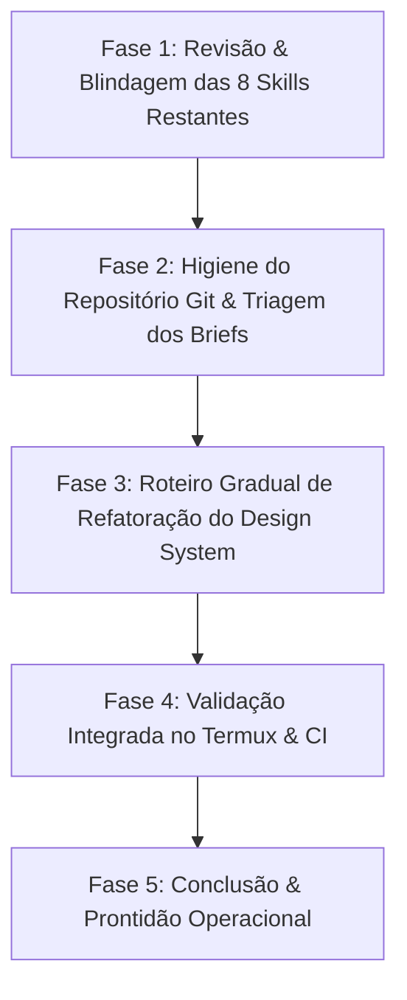

# 🛡️ Plano Mestre de Ação Segura & Zero Problemas

> **Objetivo:** Estabelecer um roteiro concreto, faseado e à prova de falhas para atualizar as Skills do projeto, higienizar o repositório Git, executar testes com estabilidade no ambiente Termux e conduzir a refatoração do Design System sem quebrar funcionalidades em produção ou introduzir regressões.

---

## 🎯 1. Mapa de Riscos & Blindagens Antecipadas

Antes de tocar em qualquer linha de código ou arquivo de configuração, mapeamos os riscos reais do projeto e as salvaguardas que impedem problemas:

| Ponto Crítico | Risco Específico | Salvaguarda / Prevenção Concreta |
| :--- | :--- | :--- |
| **Ambiente Termux (Android)** | Playwright E2E quebra nativamente por ausência de glibc; Vitest sem flags pode congelar por estouro de memória (OOM). | Executar Playwright estritamente via container Debian PRoot (`proot-distro login debian`); Rodar Vitest no Termux com flag `CI=true` e arquivos focados. |
| **Skills / Comandos Falsos** | Skills indicarem comandos inexistentes no `package.json` (ex: `test:firestore`) gerando erro nos agentes. | Auditoria estrita contra os scripts reais do `package.json` e arquivos de teste existentes. |
| **Firestore Security Rules** | Adicionar validações complexas que ultrapassem o limite rígido de **1.000 subexpressões CEL**, travando gravações de pedidos. | Batching obrigatório em grupos de 5 (`are5TagsValid`), validação diferencial em `update` e teste obrigatório via `tests/integration/orders-backend-validation.test.ts`. |
| **Cloud Functions Deploy** | O seletor estático `select-functions-deploy.mjs` quebrar no CI por import dinâmico ou acoplamento acidental. | Validação pré-deploy com `node --test tests/scripts/functions-deploy-selection.test.mjs` (executa em 150ms). |
| **Design System (478 HEX)** | Trocar 478 cores hardcoded de uma vez quebrar contraste, quebrar o carrinho ou distorcer os temas dinâmicos. | Migração faseada em 4 ondas modulares, com validação de contraste e tema a cada onda, sem substituições cegas em lote. |
| **Git / Vazamento de Dados** | Comandos cegos como `git add .` comitarem briefs internos (`BRIEF_*.md`), screenshots ou arquivos locais com credenciais. | Revisão cirúrgica de status (`git status -s`), inclusão de arquivos efêmeros em pastas adequadas ou `.gitignore`, e `git add` explícito. |

---

## 📋 2. Fases de Execução Passo a Passo



---

### Fase 1: Revisão e Atualização das 8 Skills Restantes

Cada uma das 8 skills em `.agents/skills/` (refletida em `~/.codex/skills/`) será calibrada com dados 100% verificados do repositório:

1. **`luisices-test-suite`**:
   * **Correção:** Eliminar menção a `npm run test:firestore` (inexistente); apontar para `npm run test:integration` e testes focados do Vitest.
   * **Termux Guard:** Adicionar a instrução mandatória de rodar `CI=true ./node_modules/.bin/vitest run <caminho>` para saída limpa no Termux sem sequências ANSI/TTY corrompidas.
   * **Playwright no Termux:** Documentar a execução via wrapper Debian PRoot:
     ```bash
     proot-distro login debian -- bash -c "cd /data/data/com.termux/files/home/luisices && npx playwright test tests/e2e/customers.spec.ts"
     ```
   * **Garantia:** O desenvolvedor ou agente nunca tentará rodar um comando quebrado.

2. **`luisices-functions-deploy`**:
   * **Validação Rápida:** Adicionar o comando nativo `node --test tests/scripts/functions-deploy-selection.test.mjs` (31 testes executados em ~150ms).
   * **Tratamento de Arquivos Deletados:** Documentar a exigência de nunca deixar resíduos de imports no `functions/index.js`.
   * **Divisão dos 63 Endpoints:** Categorizar os domínios (`orders`, `whatsapp`, `alexa`, `mcp`, `ai`, `users`) para evitar deploy cruzado desnecessário.

3. **`luisices-firestore-rules`**:
   * **Limites CEL:** Formalizar as fórmulas de contagem de nós AST e o uso do delimitador nulo (`\u0000`).
   * **Testes Reais:** Atualizar os caminhos dos testes de validação:
     * `tests/integration/orders-backend-validation.test.ts`
     * `tests/integration/firebase-regressions.test.ts`

4. **`luisices-order-ledger-audit`**:
   * **Scripts Oficiais:** Confirmar o uso de `npm run audit:orders`, `npm run sync:ledger` e `npm run fix-negative-values`.
   * **Regras de Negócio:** Nunca inferir ou gravar preços unitários via fallbacks genéricos (`subtotal / quantity`) sem verificar os campos canônicos no schema histórico; zero pode ser intencional. Proibir recálculos em pedidos entregues/concluídos.

5. **`luisices-cloudflare`**:
   * **Comandos Oficiais:** Confirmar os scripts com parâmetros explícitos de ambiente (`-e dev` e `-e production`).
   * **Invariante de KV:** Documentar IDs de namespace de Rate Limiting para evitar perda de configuração de borda.

6. **`git-commit-and-security`**:
   * **Checklist Pré-Commit:** Adicionar checagem ativa contra arquivos `BRIEF_*.md`, `HANDOFF_*.md`, `.secret.local`, imagens e logs.
   * **Comando de Scanner:**
     ```bash
     git diff --cached | grep -iE "(api_key|token|secret|password|bearer|authorization)"
     ```

7. **`luisices-whatsapp-integration`**:
   * **Correção de Nomes:** Substituir a menção de teste inexistente `whatsapp-conversations.test.ts` pelos arquivos reais:
     * `tests/unit/whatsapp-conversation-core.test.ts`
     * `tests/unit/whatsapp-chat-scope.test.ts`
     * `tests/integration/whatsapp-partner-scope.test.ts`
   * **Erro 463:** Procedimento de alerta para ressincronização da sessão sem loop de reenvio.

8. **`luisices-alexa-integration`**:
   * **Bateria de Testes:** Incluir execução da suíte dedicada em `tests/unit/alexa/` (`dialog.test.ts`, `interaction-model.test.ts`, `natural-dialog.test.ts`).
   * **Quarentena de Pedidos:** Reafirmar que rascunhos de pedidos gerados por voz nunca entram no `salesLedger` antes de aprovação manual.

---

### Fase 2: Higienização do Git & Triagem dos Arquivos Soltos

Atualmente o `git status -s` acusa arquivos não rastreados na raiz do repositório:
* `BRIEF_ANTIGRAVITY_VALIDACAO_ANEXOS.md`
* `BRIEF_CODEX_SEGURANCA_CUSTO_USABILIDADE.md`
* `BRIEF_CODEX_UX_LUISICES_DEV.md`
* `BRIEF_GEMINI_VALIDACAO_BACKEND_PEDIDOS.md`
* `HANDOFF_AMANHA.md`
* `PLANO_GEMINI_RECUPERACAO_TIMEOUT_PEDIDOS.md`
* `Screenshot_20261019_205612_Chrome.jpg`
* `.agents/`
* `AGENTS.md`

#### Ação Concreta:
1. **Destino da Documentação:** Criar o diretório seguro `docs/briefs/` e mover os arquivos `BRIEF_*.md`, `HANDOFF_*.md` e `PLANO_*.md` para dentro dele. Assim a raiz fica limpa e o histórico técnico é preservado.
2. **Destino das Mídias:** Mover `Screenshot_*.jpg` para `docs/assets/` ou adicionar screenshots pontuais ao `.gitignore`.
3. **Commit Isolado das Skills:**
   * Adicionar exclusivamente as skills e a constituição:
     ```bash
     git add .agents/ AGENTS.md
     git commit -m "chore(agents): register Luisices AI skills and AGENTS.md constitution"
     ```
   * Isso garante zero mistura entre ferramentas de governança e código de produto.

---

### Fase 3: Roteiro Gradual de Refatoração do Design System

Para eliminar os **478 valores HEX hardcoded** sem introduzir bugs visuais ou quebras no catálogo, a refatoração será dividida em **4 Ondas Modulares**:

```
Onda 1: Componentes Base & Containers (src/app/components/ui/)
  ├── Substituir fundos brancos/escuros por bg-background e bg-card
  └── Testar renderização nos temas: Light, Dark, Deep Ocean

Onda 2: Catálogo Público & Navegação (src/app/components/catalog/)
  ├── BannerCarousel.tsx & CatalogProductGrid.tsx
  └── Manter contraste WCAG AA nas tipografias e badges

Onda 3: Carrinho Flutuante & Checkout (CatalogCartDrawer.tsx)
  ├── Garantir legibilidade de totais, frete e botões de ação
  └── Testar em telas mobile (responsividade estrita)

Onda 4: Modais de Sucesso & WhatsApp (CatalogOrderSuccessModal.tsx)
  ├── Adequar vidros líquidos (glassmorphism tokens)
  └── Rodar npm run typecheck e testes de regressão de UI
```

#### Regra de Ouro da Refatoração:
> **Nenhum commit conterá mais de 1 domínio de UI por vez.**  
> Cada onda é testada no navegador e validada com `npm run typecheck` antes de avançar para a próxima.

---

### Fase 4: Protocolo de Testes no Termux (Sem Falhas)

Para validar o código sem sobrecarregar a memória do Android nem sofrer com erros de bibliotecas compartilhadas:

```bash
# 1. Checagem de Tipos (TypeScript estático - Rápido e Seguro)
npm run typecheck

# 2. Testes de Unidade Focados (Vitest com CI=true para saída limpa)
CI=true ./node_modules/.bin/vitest run tests/unit/cdn-and-image-optimizer.test.ts --reporter=verbose

# 3. Teste do Seletor de Deploy de Cloud Functions (Ultrarrápido com runner nativo)
node --test tests/scripts/functions-deploy-selection.test.mjs

# 4. Testes E2E com Playwright (Apenas via PRoot Debian)
proot-distro login debian -- bash -c "cd /data/data/com.termux/files/home/luisices && npx playwright test tests/e2e/customers.spec.ts"
```

---

## ✅ Resumo dos Critérios de Conclusão

Ao seguir este plano:
1. Todas as **9 Skills** ficam sincronizadas entre Antigravity e Codex, sem comandos falsos e com instruções específicas para o ambiente Termux.
2. A árvore do Git permanece limpa, sem risco de expor chaves ou PIIs.
3. O Design System passa a responder perfeitamente aos temas dinâmicos (`deep-ocean`, `forest-glow`, etc.), sem regressões no carrinho de compras.
4. O processo de deploy seletivo de Cloud Functions e as regras de segurança do Firestore continuam 100% blindados.
